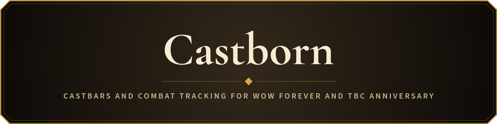
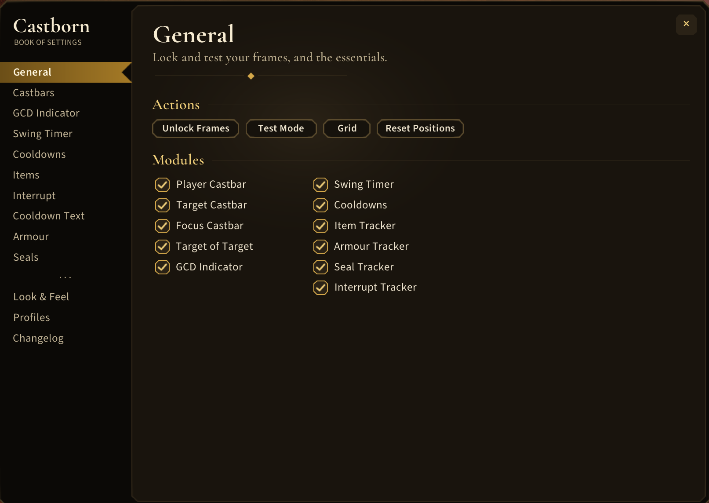
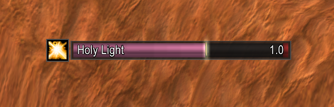
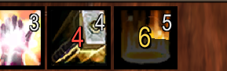
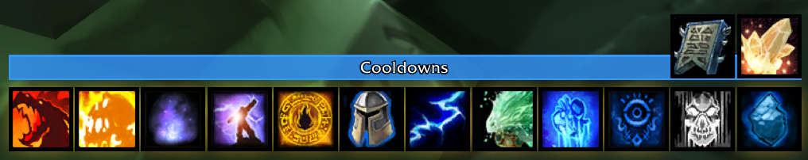
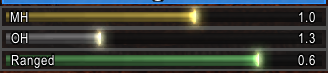
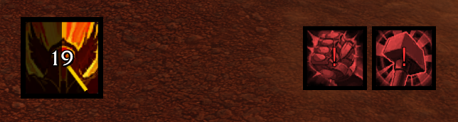
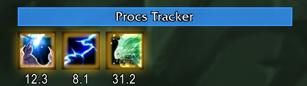
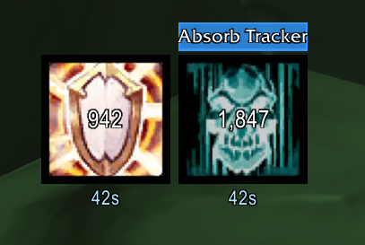
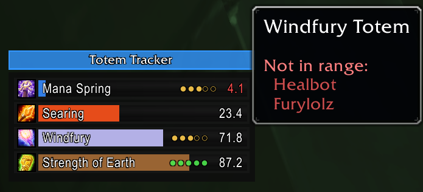

**Castbars, cooldowns and combat tracking in one addon.** One download that runs on both WoW Forever and TBC Anniversary.

Castborn replaces a handful of addons with one: castbars, health and power bars, a GCD sweep, a swing timer, cooldown, item and proc tracking, cooldown numbers on your action bars, an XP and reputation panel, and reminders for the buffs you forget. It sets itself up for your class, walks you through everything on first login, and stays out of the way.

## One addon, two games

The same files run on WoW Forever and TBC Anniversary. Forever hides some combat data from addons, so a few modules are TBC only, and some work slightly differently.

| Module | TBC | Forever | Notes on Forever |
|---|---|---|---|
| Castbars (player, target, focus, target of target) | Yes | Yes | No spark or latency overlay when the game hides a cast's timing |
| Resource Bars (health and power) | Yes | Yes | |
| GCD Indicator | Yes | Yes | |
| Swing Timer | Yes | Yes | Main hand, off hand and ranged, with an out-of-range dim |
| Cooldown Tracker | Yes | Yes | Short cooldowns can also get the ready glow, and Blizzard's own cooldown bars can be hidden |
| Cooldown Text | | Yes | Styled numbers on your action bars (including Bartender4) and Castborn's icons |
| Interrupt Tracker | Yes | Yes | Cooldown only, no lockout timer |
| Item Tracker | Yes | Yes | |
| Proc Tracker | Yes | Yes | Blizzard draws the proc icons in combat, as addons can't read buffs there |
| Armour Reminder | Yes | Yes | Checks your buffs out of combat; clears straight away when you rebuff in combat |
| Seal Tracker | Yes | Yes | |
| Five Second Rule | Yes | Yes | Starts on any cast with a mana cost, including free Clearcasting casts |
| Progress Panel (XP and reputation) | Yes | Yes | |
| DoT and Multi-DoT Trackers | Yes | | |
| Totem Tracker | Yes | | |
| Absorb Tracker | Yes | | |

## A book of settings

The options window is a dark, gilded spellbook: every module on its own page, a bookmark ribbon for the page you're on, and live previews as you change things. Everything is grouped, labelled and explained in plain English.

## Castbars

Player, target, focus and target-of-target castbars with latency, class colours, spell icons and a shield for casts you can't interrupt. Size, colour and anchor each one separately.

## Cooldowns, at a glance

Track the abilities and trinkets that matter, with a ready glow when they come back. On Forever, Castborn also puts countdown numbers on your action bars, colour-coded by time left (white, then yellow under a minute, red under five seconds), and plays a pulse, burst or flash when a cooldown finishes. It works with Blizzard's bars and Bartender4.

## Swing timer

Main hand, off hand and ranged swing bars with a glowing spark, a flash when each swing lands, and a dimmed bar when your target is out of range. Haste changes and weapon swaps are handled mid-swing.

## Reminders

The Armour Reminder flags a missing self-buff (mage and warlock armours, Inner Fire, paladin blessings, auras and Righteous Fury) or a missing Well Fed buff in dungeons and raids, and the alert pulses until you fix it. The Seal Tracker shows your active seal with its time left.

## More features

**Proc tracking**: live icons with remaining duration.

**Absorb tracking** (TBC Anniversary): remaining shield amount and time left.

**Totem tracking** (TBC Anniversary): durations, pulse pips and party range checks.

## Getting started

1.  Install from CurseForge, or extract to `Interface/AddOns/Castborn`.
2.  Log in. A short guided tour starts automatically.
3.  Type `/cb` to open the options at any time.

Castborn comes set up for your class, so most people never need to change much.

## Commands

*   `/cb` - open the options
*   `/cb test` - preview every module so you can position them
*   `/cb unlock` and `/cb lock` - drag frames into place, then lock them
*   `/cb grid` - show an alignment grid
*   `/cb reset` - put every frame back in its default place
*   `/cb tutorial` - replay the guided tour

## Features

*   **Guided tour**: a step-by-step introduction to each module on first login.
*   **Test mode**: see and move everything without being in combat.
*   **Alignment grid** and **anchoring**: snap frames into place, or attach modules to your castbar.
*   **Profiles**: save, copy and share your setup between characters.
*   **Masque** support for Castborn's icons.
*   **LibSharedMedia** textures and fonts.
*   **Bartender4** support for cooldown numbers on Forever.

## Feedback and support

Found a bug or have an idea? Use the Issues tab here, or [GitHub issues](https://github.com/afrugalpenguin/castborn/issues).

## Credits

Castborn ships two typefaces under the SIL Open Font License: **Cormorant Garamond** by Christian Thalmann (Catharsis Fonts) and **Source Sans 3** by Adobe.
