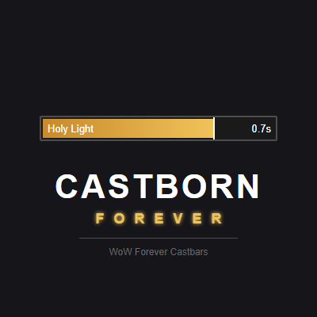
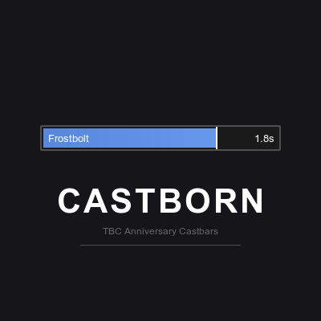
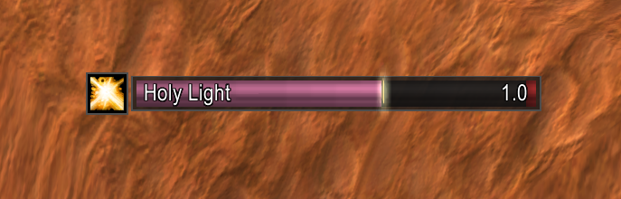
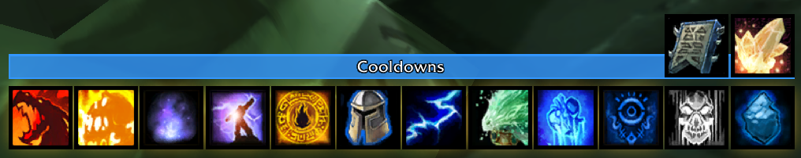
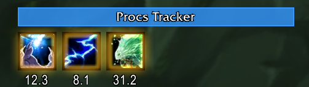
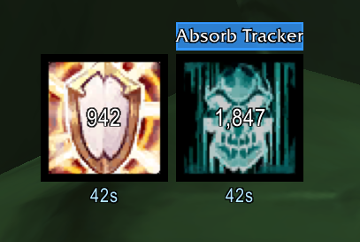
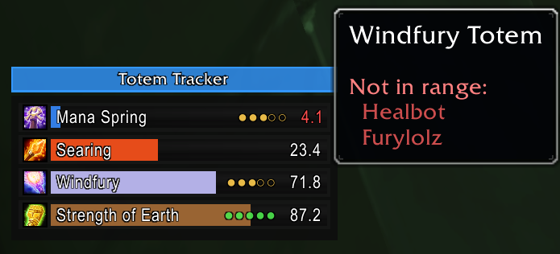
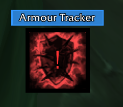
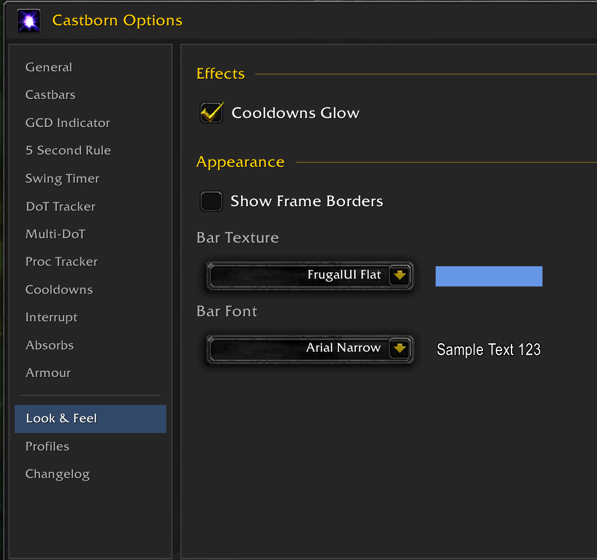
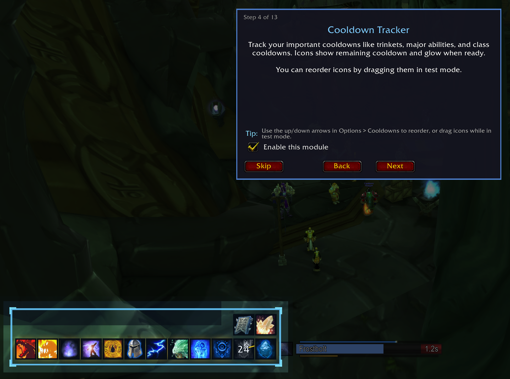

# Castborn

  
  

  
  
  
  
  
  

  <b>A lightweight combat HUD for TBC Classic and WoW Forever</b> 
  Clean, minimalist, essential.

---

Castborn gives you everything you need to track casts, cooldowns, DoTs, and procs — all in one addon. No dependencies and no bloat.

## Why Castborn?

- **All-in-one** — Replace 5+ addons with a single, cohesive package
- **Lightweight** — Minimal memory footprint, no performance impact
- **Just works** — Smart defaults for every class, guided setup for new users
- **Fully customisable** — Move anything, resize anything, toggle anything

## WoW Forever

Castborn also runs on World of Warcraft: Forever, from the same download. Forever hides some combat data from addons, so for now it has:

- Player, Target, Focus and Target-of-Target castbars
- GCD Indicator
- Cooldown Tracker, including trinket cooldowns
- Interrupt Tracker (cooldown only, no lockout timer)
- Item Tracker
- Armour Tracker (checks out of combat only)

A few details differ on Forever: castbars whose timings are hidden show no spark or latency overlay, short cooldowns can also get the ready glow, and Earth Shield and Water Shield charges are not shown.

Not yet on Forever: Five Second Rule, Swing Timer, DoT and Multi-DoT trackers, Proc Tracker, Totem Tracker and Absorb Tracker. Their option pages are hidden on Forever, and they keep working as before on TBC.

## What's Included

### Castbars

Player, Target, Focus, and Target-of-Target castbars with latency indicators, class colours, and shield icons for uninterruptible spells. *(TBC and Forever)*

### Tracking Modules

- **GCD Indicator** — See your global cooldown at a glance *(TBC and Forever)*
- **Five Second Rule** — Know exactly when your mana regen kicks in
- **Swing Timer** — Track mainhand, offhand, and ranged auto-attacks
- **DoT Tracker** — Monitor debuffs on your current target
- **Multi-DoT Tracker** — Keep DoTs up on multiple mobs simultaneously
- **Proc Tracker** — Never miss Clearcasting, Nightfall, or trinket procs
- **Cooldown Tracker** — Track important abilities with per-spell toggles *(TBC and Forever)*
- **Interrupt Tracker** — Know when your kick is ready *(TBC and Forever; no lockout timer on Forever)*
- **Totem Tracker** — Shaman-only: track active totems and party coverage
- **Absorb Tracker** — Track Ice Barrier, Mana Shield, Power Word: Shield, and all TBC absorb effects with remaining amount and drain visualisation
- **Armour Tracker** — Mage and Warlock only: warns when your armour self-buff (Frost/Ice/Mage/Molten or Demon/Fel Armor) is missing

## Screenshots

<table>
  <tr>
    <td width="50%" align="center">
       
      <b>Deep castbar customisation</b> 
      Class colours, global colour, latency, and per-bar sizing
    </td>
    <td width="50%" align="center">
       
      <b>Cooldown &amp; trinket tracking</b> 
      Abilities and on-use trinkets with ready glow
    </td>
  </tr>
  <tr>
    <td width="50%" align="center">
       
      <b>Proc tracking</b> 
      Live icons with remaining duration
    </td>
    <td width="50%" align="center">
       
      <b>Absorb tracking</b> 
      Remaining shield amount and time left
    </td>
  </tr>
  <tr>
    <td width="50%" align="center">
       
      <b>Totem tracking</b> 
      Durations, pulse pips, and party range checks
    </td>
    <td width="50%" align="center">
       
      <b>Armour reminder</b> 
      Flags a missing Mage/Warlock armour buff
    </td>
  </tr>
  <tr>
    <td width="50%" align="center">
       
      <b>Look &amp; Feel</b> 
      LibSharedMedia bar textures and fonts
    </td>
    <td width="50%" align="center">
       
      <b>Guided onboarding</b> 
      Step-by-step tour of every module
    </td>
  </tr>
</table>

## Getting Started

1. Install from CurseForge or extract to `Interface/AddOns/Castborn`
2. Log in — the guided tour starts automatically
3. Type `/cb` to open options anytime

That's it. Castborn comes pre-configured with sensible defaults for your class.

## Commands

- `/cb` — Open options panel
- `/cb test` — Preview all modules
- `/cb unlock` — Drag frames to reposition
- `/cb lock` — Lock frames in place
- `/cb grid` — Toggle alignment grid
- `/cb reset` — Reset to default positions
- `/cb tutorial` — Replay the guided tour

## Features

- **Guided onboarding** — Step-by-step tour introduces each feature
- **Test mode** — See and position everything without being in combat
- **Layout grid** — Snap frames for pixel-perfect alignment
- **Ctrl+Shift hide** — Temporarily hide overlapping modules while positioning
- **Anchor system** — Modules can follow your player castbar
- **Profile system** — Save, copy, and share configurations
- **Masque support** — Skin proc icons with your favourite theme
- **LibSharedMedia support** — Choose custom bar textures and fonts in the Look & Feel panel

## Feedback & Support

Found a bug? Have a suggestion?

- [CurseForge Issues](https://www.curseforge.com/wow/addons/castborn/issues)
- [GitHub Issues](https://github.com/afrugalpenguin/castborn/issues)
